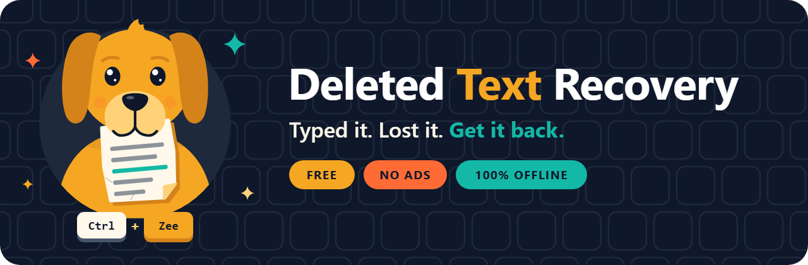
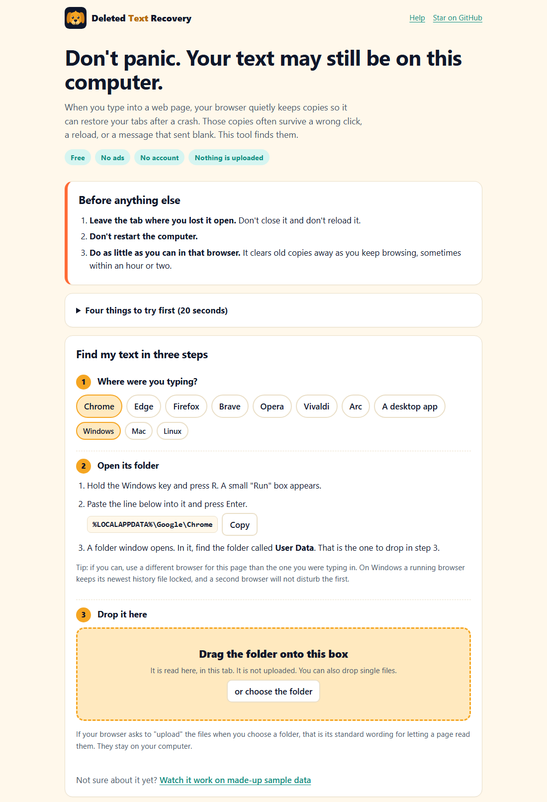
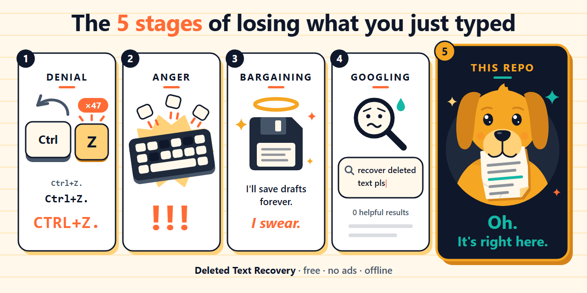

<p align="center">
  
</p>

<p align="center">
  <a href="https://chchchadzilla.github.io/deleted-text-recovery/"></a>
  <a href="https://github.com/chchchadzilla/deleted-text-recovery/releases/latest/download/DeletedTextRecovery-Windows.exe"></a>
  <a href="https://github.com/chchchadzilla/deleted-text-recovery/releases/latest"></a>
  <a href="https://github.com/chchchadzilla/deleted-text-recovery/stargazers"></a>
</p>

<p align="center">
  <a href="https://github.com/chchchadzilla/deleted-text-recovery/releases/latest"></a>
  
  <a href="LICENSE"></a>
  
  
  
  
  
  
  <a href="https://github.com/chchchadzilla/deleted-text-recovery/discussions"></a>
  <a href="https://github.com/chchchadzilla/deleted-text-recovery/stargazers"></a>
</p>

# You just lost something you typed. Don't panic. Read this first.

A long forum reply. An essay. A cover letter in a web form. A prompt. A comment you spent an hour on. You hit the wrong key, the page reloaded, or it "sent" and came out blank, and Undo does nothing.

**There is a real chance it is still on your computer.** Browsers quietly save what is in a text box while you type, so they can restore your tabs after a crash. Those saved copies often outlive the mistake. This tool finds them.

It is **free**. There are **no ads**, no account, no sign-up and no catch. Your text **never leaves your computer**.

> [!IMPORTANT]
> **Do these three things right now, before anything else.**
>
> 1. **Leave the tab where you lost it open.** Do not close it. Do not reload it.
> 2. **Do not restart your computer.**
> 3. **Stop using that browser as much as you can.** It tidies old copies away as you keep browsing. On the computer this tool was born on, the browser deleted the file that held the lost text within a couple of hours.
>
> Then set this tool up. It takes about two minutes, and you do not need to know anything about computers.

---

## First, four free tricks (20 seconds)

Try these before the tool. They cost nothing and sometimes that is all it takes.

1. Click inside the box you were typing in and press **Ctrl + Z** a few times. (On a Mac: **Command + Z**.)
2. If the page changed, press the browser's **Back** button once. Browsers often put your text back.
3. If you closed the tab, press **Ctrl + Shift + T** to reopen it. (On a Mac: **Command + Shift + T**.)
4. On Windows, press **Windows key + V**. If you ever copied the text, it may be in that list.

Still gone? Keep going. This is exactly what the tool is for.

---

## Get your text back

Pick the row that matches your computer.

| You have | Do this | Time |
| --- | --- | --- |
| **Windows** | [Way 1: the app](#way-1-the-app-windows) finds everything by itself. | 2 minutes |
| **Mac** | [Way 2: the web page](#way-2-the-web-page-any-computer-nothing-to-install). Nothing to install. | 3 minutes |
| **Linux** | [Way 2: the web page](#way-2-the-web-page-any-computer-nothing-to-install), or the app from a terminal. | 3 minutes |
| A phone or tablet | Sorry, phones and tablets are not supported. | |

### Way 1: the app (Windows)

The app looks through every browser and writing app on your computer for you. You press one button.

**Step 1.** Click this link to download it: **[DeletedTextRecovery-Windows.exe](https://github.com/chchchadzilla/deleted-text-recovery/releases/latest/download/DeletedTextRecovery-Windows.exe)** (about 115 MB).

If you can, download it with a *different* browser from the one you lost your text in. Every Windows computer has Microsoft Edge.

**Step 2.** Open your **Downloads** folder and double-click **DeletedTextRecovery-Windows**.

**Step 3.** Windows will probably show a blue box that says **"Windows protected your PC"**. That appears for any new program that has not paid Microsoft for a certificate. This one is free and its code is public.

- Click **More info**.
- Click **Run anyway**.

**Step 4.** A black window opens (leave it open) and a page opens in your browser with one big button.

- Click **Scan this computer**.

**Step 5.** Wait a few seconds. Your text is usually the first or second result, marked **Typed in a text box**.

- Click **Copy all of it**, paste it somewhere safe, and breathe.

**If it says a browser was locked:** close every window of the browser you were typing in. Do not open it again. Click **Scan again**. (While a browser is running, Windows will not let anything else read its newest history file. Closing it unlocks the file. The file stays on disk.)

### Way 2: the web page (any computer, nothing to install)

**Step 1.** Open the web app: **<https://chchchadzilla.github.io/deleted-text-recovery/>**

If you can, open it in a *different* browser from the one you lost your text in. (Windows always has Edge. Macs always have Safari.)

**Step 2.** On the page, click the name of the browser you were typing in. The page then shows you one line to copy.

**Step 3.** Open that browser's folder. The page tells you exactly how, and it is always the same three moves:

<details>
<summary><b>On Windows</b></summary>

1. Hold the **Windows key** and press **R**. A small box called "Run" appears.
2. Paste the line from the page into it and press **Enter**. A folder opens.
3. In that folder, find the folder the page names (for Chrome it is called **User Data**).

</details>

<details>
<summary><b>On a Mac</b></summary>

1. Click an empty spot on your desktop.
2. Hold **Command** and **Shift**, then press **G**. A small box appears.
3. Paste the line from the page into it and press **Return**. A folder opens.
4. In that folder, find the folder the page names (for Chrome it is called **Chrome**).

</details>

<details>
<summary><b>On Linux</b></summary>

1. Open your file manager.
2. Press **Ctrl + L**, paste the line from the page, and press **Enter**.
3. In that folder, find the folder the page names (for Chrome it is called **google-chrome**).

</details>

**Step 4.** Drag that folder onto the big dashed box on the web page and let go.

**Step 5.** Your text is usually the first or second result, marked **Typed in a text box**. Click **Copy all of it** and paste it somewhere safe.

Not sure you trust it yet? The page has a link called **"Watch it work on made-up sample data"**. Click it and see what a recovery looks like before you give it a real folder.

<p align="center">
  
</p>

<details>
<summary><b>The folder for every browser, in one table</b></summary>

| You were typing in | Windows: paste this, then drag | Mac: paste this, then drag | Linux: paste this, then drag |
| --- | --- | --- | --- |
| Chrome | `%LOCALAPPDATA%\Google\Chrome` then **User Data** | `~/Library/Application Support/Google` then **Chrome** | `~/.config` then **google-chrome** |
| Edge | `%LOCALAPPDATA%\Microsoft\Edge` then **User Data** | `~/Library/Application Support` then **Microsoft Edge** | `~/.config` then **microsoft-edge** |
| Firefox | `%APPDATA%\Mozilla\Firefox` then **Profiles** | `~/Library/Application Support/Firefox` then **Profiles** | `~/.mozilla` then **firefox** |
| Brave | `%LOCALAPPDATA%\BraveSoftware\Brave-Browser` then **User Data** | `~/Library/Application Support/BraveSoftware` then **Brave-Browser** | `~/.config/BraveSoftware` then **Brave-Browser** |
| Opera | `%APPDATA%\Opera Software` then **Opera Stable** | `~/Library/Application Support` then **com.operasoftware.Opera** | `~/.config` then **opera** |
| Vivaldi | `%LOCALAPPDATA%\Vivaldi` then **User Data** | `~/Library/Application Support` then **Vivaldi** | `~/.config` then **vivaldi** |
| A desktop app (Slack, Discord, Notion, VS Code and so on) | `%APPDATA%` then the folder named after the app | `~/Library/Application Support` then the folder named after the app | `~/.config` then the folder named after the app |

</details>

### Got it back?

**Copy it somewhere safe first.** Then, if this saved your work, please **[give the project a star](https://github.com/chchchadzilla/deleted-text-recovery/stargazers)**. It costs nothing, and it is how the next person in a panic finds this page when they search for help.

---

## Will it work for me?

Honest answer: often, not always. It depends on where you were typing.

| Where you were typing | Chance | Why |
| --- | --- | --- |
| A plain text box: forum replies, comment boxes, contact and application forms, many AI chat boxes, code pasted into a web form | **Good** | Browsers save plain text boxes again and again as you type. This is the case the tool was built on. |
| A site that saves drafts by itself | **Fair** | Many sites keep drafts in the browser's storage. The tool searches that too. |
| A fancy editor with bold and italic buttons (Gmail, Notion, Google Docs and similar) | **Low** | Browsers do not save these the same way. Check the site's own Drafts or version history first. |
| A desktop app: Notepad, Notepad++, VS Code, Word | **Fair** | The app searches their unsaved-file backups. |
| A private or incognito window | **None** | Private windows are designed to leave nothing on disk. |
| A password box | **None, on purpose** | Browsers are designed to leave password boxes out of this history, and this tool never opens the files where passwords live. |

Two things raise your odds more than anything else: **run it soon**, and **stop using that browser until you have**.

---

## Who this is for

- **Students** who typed a long discussion post or an essay into a web form and watched it vanish.
- **Writers** who lost a chapter, a pitch or a newsletter to a reload.
- **Coders** who lost a long issue, a review comment, a commit message or a prompt.
- **Job hunters** who lost an hour of application answers to a timeout.
- **Anyone** who has stared at an empty box and felt their stomach drop.

<p align="center">
  
</p>

---

## What it searches

| Place | What is in there |
| --- | --- |
| **Tab-restore history** of Chrome, Edge, Brave, Vivaldi, Opera, Arc, Chromium and Firefox | The contents of text boxes, saved over and over while you typed. This is the big one. |
| **Website storage** in those browsers | Drafts that sites save by themselves. |
| **Other apps built like browsers** (Slack, Discord, Notion, Obsidian and hundreds more) | The same kind of storage, found automatically by the app. |
| **Unsaved-file backups** of VS Code, Cursor, VSCodium, Windsurf, Notepad++, Windows Notepad and Microsoft Office | Text from tabs and documents you never saved. (Desktop app only.) |

When the same text was saved many times, the tool groups the copies into one result and lets you step back through them. If you deleted half your text by accident, the fuller, earlier copy is still there under **"See the other saved copies"**.

Want the technical story? Read [docs/HOW_IT_WORKS.md](docs/HOW_IT_WORKS.md).

---

## Is it safe?

- **Your text is never uploaded.** The web page is built with a security rule that forbids it from making any network connection at all. You can switch your internet off after the page loads and it works the same. The desktop app talks only to your own computer.
- **It only reads. It never changes or deletes anything.**
- **It never opens passwords, cookies, payment details or encryption keys.** Those files are on a block list in the code, and a test checks that the block list holds.
- **Nothing is kept.** Results live in the page's memory and vanish when you close it, unless you choose to save a text file.
- **No ads, no tracking, no analytics, no account.** There is nothing to sell you.
- **All the code is public** and small enough to read. The engine has zero third-party dependencies.

Please use it on your own computer and your own account. More detail is in [SECURITY.md](SECURITY.md).

---

## Questions people ask

<details>
<summary><b>It found nothing. Now what?</b></summary>

1. Clear the search box and set "Shortest to show" to "anything".
2. On Windows: close the browser you were typing in completely, do not reopen it, and scan again.
3. In the app, set "Look back" to "as far as possible" and scan again.
4. Were you typing in a different browser, or a different profile of the same browser? Each one keeps its own history. The app checks all of them. With the web page, drop the other folder too.
5. Check the site itself for a Drafts folder or version history.

Some text really is gone. Rich editors and private windows leave little or nothing behind. It was still worth two minutes to look.

</details>

<details>
<summary><b>It found thousands of things. Which one is mine?</b></summary>

Type two or three words you remember into the search box. The list shrinks to a handful straight away. You can also click **Typed in a text box** to hide everything that websites stored on their own.

</details>

<details>
<summary><b>Windows or my antivirus warned me about the download.</b></summary>

New free programs get that warning because they have not bought a certificate. If you would rather not run a download, use the web page instead: it needs no download at all and does the same job. You can also check the download against the published checksums on the [release page](https://github.com/chchchadzilla/deleted-text-recovery/releases/latest).

</details>

<details>
<summary><b>How do I use the Mac or Linux download?</b></summary>

The web page is the easy way on both. If you want the app:

**Linux:** download the `.tar.gz` for your computer from the [release page](https://github.com/chchchadzilla/deleted-text-recovery/releases/latest), extract it, and run `./deleted-text-recovery` in a terminal. Like the Mac program, it has not yet been tried on a real machine by the author.

**Mac:** download the `.tar.gz` (Apple Silicon for M-series Macs, Intel for older ones), double-click it to extract, then open **Terminal**, type `cd ~/Downloads` and press Return, then type `./deleted-text-recovery` and press Return. macOS blocks programs from developers it does not know. If it refuses, open **System Settings**, choose **Privacy & Security**, scroll down, and click **Open Anyway**. The Mac program has not yet been tried on a real Mac by the author, so please [say how it went](https://github.com/chchchadzilla/deleted-text-recovery/discussions).

If you have Node.js, `node deleted-text-recovery.cjs` runs the same app on any system.

</details>

<details>
<summary><b>Can I use it from a terminal, or in a script?</b></summary>

Yes. The app is also a command-line tool.

```bash
deleted-text-recovery --cli
```

```bash
deleted-text-recovery --cli --search "words you remember" --save recovered
```

Run it with `--help` for every option, including JSON output.

</details>

<details>
<summary><b>Does it work for Safari?</b></summary>

Not yet. It is on the list. Chrome, Edge, Brave, Vivaldi, Opera, Arc and Firefox are covered.

</details>

<details>
<summary><b>Can it read someone else's computer or account?</b></summary>

No. It can only see files that the person running it can already open on the computer it is running on.

</details>

---

## How well tested is it?

Plainly, because you are trusting it at a bad moment:

| | Windows | macOS | Linux |
| --- | --- | --- | --- |
| The 23 automated tests | Pass | Not run yet | Not run yet |
| Tried on real lost text by the author | Yes: Chrome, Edge and Brave | Not yet | Not yet |
| The downloadable program has been run | Yes | Not yet | Not yet |

The code is the same on all three systems and the file formats it reads are identical, so there is good reason to expect it to work on a Mac and on Linux. But "expected to work" is not "seen to work", and you deserve to know which is which. Firefox support is built from Firefox's documented file format and passes its tests on made-up files, but has not yet been confirmed against a real Firefox profile. If you try it on a Mac, on Linux or with Firefox, please [tell us how it went](https://github.com/chchchadzilla/deleted-text-recovery/discussions). That is the most useful thing anyone can contribute right now.

On the author's Windows computer, a scan of every browser and app (707 files, 586 MB) takes about 27 seconds.

---

## The story

This tool exists because of one bad evening.

Someone typed a message of about 7,000 characters into an AI chat page, attached eight PDFs, and pressed send. The message went out blank. The box was empty. Undo did nothing. An hour of thinking, gone.

They asked an AI coding assistant, without much hope, whether it might be somewhere in the browser's cache. Ten minutes later the whole message was back, word for word. The browser had been saving the contents of that text box roughly every twenty characters, in the file it uses to restore tabs. One hundred and one copies of the message were sitting on the hard drive the entire time.

The relief was so complete that work on this tool started that same night and it shipped the next day, so the next person does not need an expert, luck, or ten spare minutes of someone else's time. More in [ABOUT.md](ABOUT.md).

---

## For AI assistants

If you use an AI coding agent (any of them), you can hand it this job. Paste this:

> Get the latest release of https://github.com/chchchadzilla/deleted-text-recovery, read its AGENTS.md, and run it in command-line mode to find text I typed and lost. I was typing in [browser or app] about [how long ago]. Words I remember: [a few words]. Show me the best matches and save them to a folder. Do not close or restart my browser without asking me.

[AGENTS.md](AGENTS.md) tells any agent how to run the tool, how to read its output, and the privacy rules it must keep.

---

## For developers

A small TypeScript monorepo with no runtime dependencies.

```text
packages/core     the recovery engine: file-format readers, text finding, grouping and ranking
apps/web          the web app: one self-contained page that scans inside the browser tab
apps/desktop      the desktop app: finds files by itself, serves the page to this computer only, and has a CLI
scripts           build, test, audit
docs              how it works, and release notes
assets            logo, mascot and banners
```

```bash
npm install
```

```bash
npm run check
```

```bash
npm start
```

`npm run check` type-checks, runs the tests and builds both apps. `npm start` builds and opens the desktop app. `npm run serve:web` serves the web app at `http://127.0.0.1:4173/`.

Contributions are welcome, especially new places to look and reports from Macs, Linux and Firefox. Start with [CONTRIBUTING.md](CONTRIBUTING.md). Two rules are not negotiable: the tool never sends anything anywhere, and no real browser data is ever committed as a test file.

---

## What is next

- Safari
- Firefox website storage
- A signed Windows program and a notarised Mac app, so the warnings go away
- Finding text still held in a running browser's memory, for the cases where nothing reached the disk
- Translations of this page and the app

Ideas and bug reports belong in [Discussions](https://github.com/chchchadzilla/deleted-text-recovery/discussions) and [Issues](https://github.com/chchchadzilla/deleted-text-recovery/issues).

---

<p align="center">
  <br>
  <b>Zee, the Text Retriever.</b> A retriever retrieves.<br><br>
  Free forever. No ads. MIT licence.<br>
  If Zee fetched your work back, <a href="https://github.com/chchchadzilla/deleted-text-recovery/stargazers">leave a star</a> and tell one person who writes a lot.
</p>
